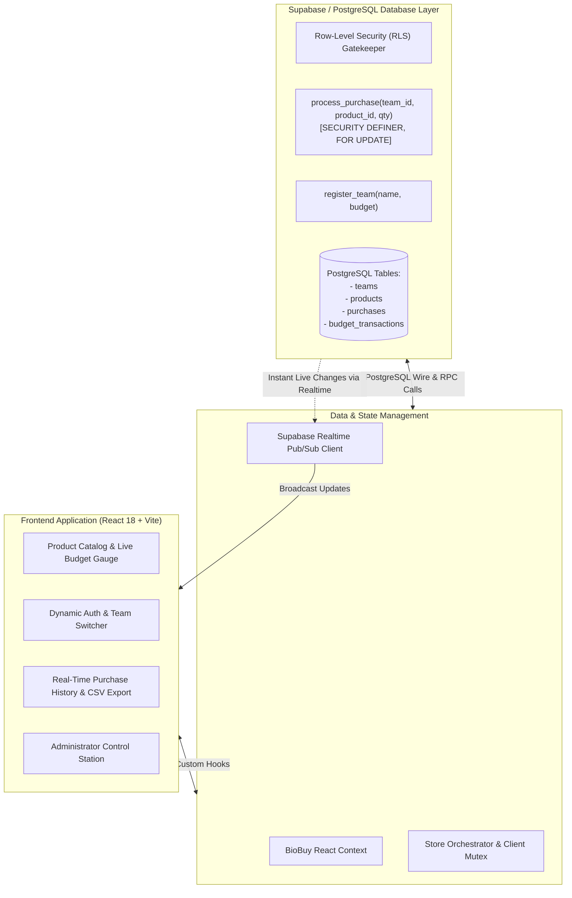

# 🧬 BioBuy — Biotech Procurement & Hackathon Marketplace

> **"Equip Your Lab. Empower Your Research."**  
> A high-concurrency, real-time biotechnology marketplace engineered for scientific research teams and university hackathon challenges.

[](https://react.dev/)
[](https://www.typescriptlang.org/)
[](https://supabase.com/)
[](https://tailwindcss.com/)
[](https://vitejs.dev/)
[](https://opensource.org/licenses/MIT)

---

## 📌 Executive Overview

**BioBuy** is a modern, high-throughput procurement platform designed for competitive biotechnology hackathons, student labs, and research teams.

In competitive university hackathons, multiple teams often rush to purchase scarce biological reagents and hardware simultaneously. BioBuy eliminates race conditions and double-spending through **server-side ACID transactions** (`SECURITY DEFINER` stored procedures with row-level locks) and provides **sub-50ms live synchronization** across all competing teams.

---

## 🏛️ System Architecture



---

## 🚀 Key Engineering Capabilities

### 1. Guaranteed ACID Transactions (Zero Double-Spending)
* Custom PostgreSQL stored procedure `process_purchase(...)` runs with `SECURITY DEFINER` and executes row-level pessimistic locks (`SELECT ... FOR UPDATE`).
* Atomically verifies product stock, validates remaining team balance, decrements global inventory, creates immutable purchase records, and updates budget ledgers in a single atomic database transaction.

### 2. Multi-Tenant Row-Level Security (RLS)
* Granular PostgreSQL security policies enforce that teams can only inspect their own budget transaction history.
* Anonymous and contestant visitors can browse active catalog inventory, while administrative catalog modifications require JWT role verification.

### 3. Real-Time Distributed Synchronization
* Subscribed to **Supabase Realtime PostgreSQL Change Data Capture (CDC)**.
* When Team Alpha buys 3 units of PCR Master Mix, Team Beta's inventory count updates from 20 to 17 units across all active browser sessions in real-time with zero page refresh.

### 4. Comprehensive 7-Category Product Catalog
1. **Laboratory Equipment** (Micropipettes, Centrifuges, pH Meters, Vortex Mixers)
2. **Reagents and Raw Materials** (Agarose, PBS Tablets, Tris-HCl Buffer, Nuclease-Free Water)
3. **Assay Kits** (Bradford Protein Assay, BCA Protein Assay, MTT Cell Viability)
4. **Molecular Biology** (gDNA Extraction Kits, RNA Purification Kits, 2X Taq Master Mix)
5. **Cell Culture** (T-75 Culture Flasks, DMEM High-Glucose Medium, Serological Pipettes)
6. **Laboratory Consumables** (Pipette Tips, 1.5 mL Safe-Lock Tubes, Nitrile Gloves)
7. **Analytical Instruments** (Nanodrop Spectrophotometer, Digital TDS Tester)

---

## ⚡ Quickstart & Local Setup

### 1. Clone the Repository
```bash
git clone https://github.com/adityagupta2716-hub/Biobuy.git
cd Biobuy
```

### 2. Install Dependencies
```bash
npm install
```

### 3. Run Development Server
```bash
npm run dev
```
Open [http://localhost:5173](http://localhost:5173) in your browser.

### 4. Database Setup (Optional)
To connect your own Supabase instance:
```env
VITE_SUPABASE_URL=https://your-project.supabase.co
VITE_SUPABASE_ANON_KEY=your-anon-key
```
Migrations are automatically provided in `supabase/migrations/`.

---

## 📄 License
This project is licensed under the [MIT License](LICENSE).
